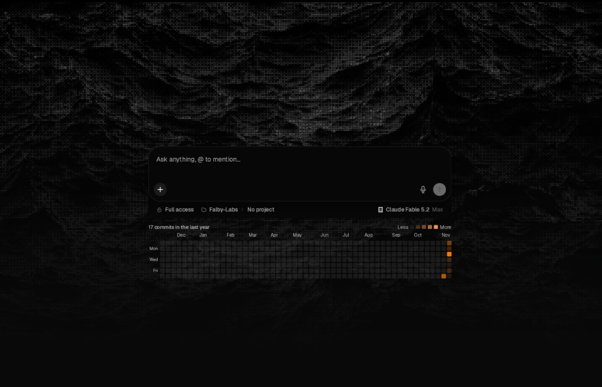

# Plugin Zeron buatan Falbyarts

Kumpulan plugin **Zeron** yang saya buat sendiri — bukan plugin bawaan Zeron.



Semua plugin di sini gratis, sumbernya terbuka, dan berjalan **di komputer kamu
sendiri**. Tidak ada data yang dikirim ke server mana pun.

## Daftar plugin

| Plugin | Fungsi | Versi | Panduan |
| --- | --- | --- | --- |
| **Heatmap-LocLabs** | Heatmap setahun commit Git di bawah kotak chat New Chat. Arahkan kursor ke satu hari untuk melihat daftar commit hari itu — kartunya bisa di-scroll, dan ada tombol refresh di samping jumlah commit. | 1.3.0 | [Baca panduan](docs/heatmap-loclabs.md) |

---

## Cara memasang plugin (untuk pemula)

Pilih **salah satu** cara di bawah. Cara 1 paling mudah dan tidak perlu Git.

### Sebelum mulai

- Zeron sudah terpasang dan sedang terbuka.
- Ada koneksi internet untuk mengunduh plugin.
- Khusus Heatmap-LocLabs: **Git** harus terpasang di komputer.
  Belum punya? Unduh di <https://git-scm.com/download/win>, lalu install
  seperti aplikasi biasa (klik Next sampai selesai).

### Cara 1 — dari link rilis (paling mudah)

1. Buka halaman rilis Heatmap-LocLabs:

   <https://github.com/Falbyarts/My-Zeron-Plugin/releases/tag/heatmap-loclabs-v1.3.0>

2. **Salin alamat halaman itu** dari address bar browser
   (klik address bar, tekan `Ctrl+C`).

3. Buka Zeron, lalu klik **ikon gerigi** (Settings).

4. Pilih **Plugins**.

5. Klik tombol **Install…**

6. **Tempel** alamat tadi (`Ctrl+V`), lalu klik **Install**.

7. Zeron menampilkan daftar izin yang diminta plugin. Baca sebentar, lalu klik
   **Allow** / **Izinkan**.

8. Selesai. Buka **New Chat** — heatmap muncul di bawah kotak chat.

> Jika tombol **Install…** tidak ada, perbarui Zeron ke versi terbaru dulu.

### Cara 2 — dari file `.zeron-plugin`

Cara ini cocok kalau kamu lebih suka mengunduh file langsung.

1. Buka halaman rilis di atas.

2. Di bagian **Assets**, klik file
   `heatmap-loclabs-1.3.0.zeron-plugin` untuk mengunduh.

3. Buka Zeron → **Settings** → **Plugins** → **Install…**

4. Pilih file yang baru saja diunduh.

5. Klik **Allow** / **Izinkan** saat Zeron bertanya.

6. Buka **New Chat** untuk melihat hasilnya.

> **Jangan diekstrak.** File `.zeron-plugin` dipasang langsung lewat Zeron,
> bukan dibuka dengan WinRAR atau sejenisnya.

### Cara 3 — langsung dari source code (butuh Git)

Cocok kalau kamu ingin plugin bisa dicek pembaruannya otomatis.

Di Zeron → **Settings** → **Plugins** → **Install…**, tempel alamat ini:

```text
https://github.com/Falbyarts/My-Zeron-Plugin/tree/main/plugins/heatmap-loclabs
```

Cara ini membutuhkan Git yang sudah terpasang dan dikenali Zeron.

---

## Kalau ada masalah

| Yang terjadi | Yang bisa dilakukan |
| --- | --- |
| Tombol **Install…** tidak ditemukan | Perbarui Zeron ke versi terbaru. |
| Muncul pesan `git_missing` | Install Git dari <https://git-scm.com/download/win>, lalu tutup dan buka lagi Zeron. |
| Muncul pesan `tampered` atau `other_signer` | Unduh ulang file dari halaman rilis resmi ini. Jangan mengedit isi file plugin. |
| Heatmap kosong, tidak ada kotak berwarna | Pastikan folder yang kamu buka di Zeron adalah repo Git dan sudah punya commit. |
| Tertulis “Reading your commits…” terus | Git belum terbaca oleh Zeron. Install Git, lalu restart Zeron. |
| Tertulis “Allow Heatmap-LocLabs…” | Plugin belum diizinkan. Buka Settings → Plugins, lalu izinkan plugin itu. |
| Kartu commit tidak muncul saat kursor diarahkan | Pastikan kamu ada di **New Chat**, lalu arahkan kursor tepat ke kotak hari yang berwarna dan tunggu sebentar. |

Masih bermasalah? Buka **Issues** di repository ini dan tuliskan:
versi Zeron, versi Windows, dan pesan error yang muncul.

---

## Isi repository

```text
plugins/                 plugin Zeron, satu folder per plugin
  heatmap-loclabs/       Heatmap-LocLabs 1.3.0 (siap dipasang)
docs/                    panduan tiap plugin
assets/                  gambar untuk dokumentasi
```

Setiap folder di `plugins/` adalah satu plugin Zeron yang sudah ditandatangani.
Jangan mengubah isinya kalau ingin dipasang lewat Zeron.

Panduan membuat dan merawat plugin (dari dalam Zeron):
[docs/development.md](docs/development.md).

## Privasi

- Plugin membaca **hanya folder lokal** yang dipakai chat dan project di
  komputer ini.
- Tidak ada commit, nama, email, atau isi file yang dikirim ke internet.
- Tidak perlu akun GitHub untuk memakai plugin.
- Kode sumbernya terbuka, jadi siapa pun bisa memeriksanya.

## Lisensi

[MIT](LICENSE) — bebas dipakai, diubah, dan dibagikan dengan tetap mencantumkan
nama pembuatnya.
