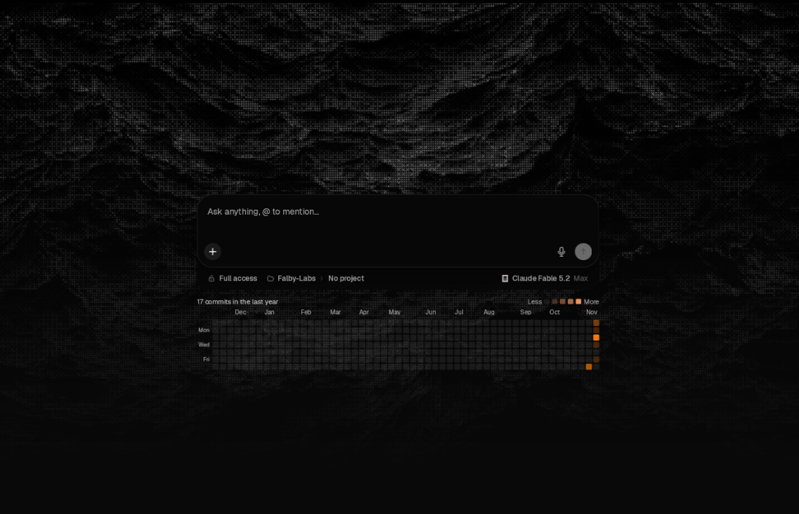

# Heatmap-LocLabs



**Heatmap-LocLabs** menampilkan aktivitas **commit Git lokal selama satu tahun terakhir** dalam bentuk grid kotak harian tepat di bawah kotak chat **New Chat**. Semakin terang warna kotaknya, semakin banyak commit pada hari tersebut.

Saat kursor diarahkan ke kotak hari yang berwarna, muncul **kartu tooltip** berisi tanggal lengkap, jumlah commit, serta hingga **10 commit terbaru** hari itu (lengkap dengan jam dan pesan commit). Jika ada lebih dari 10 commit, sisanya diringkas sebagai **+N more**.

Di samping tulisan jumlah commit tersedia tombol **refresh** kecil untuk membaca ulang seluruh folder Git saat itu juga dan langsung memperbarui angka, warna grid, serta kartu detail commit tanpa perlu menunggu cache 5 menit atau me-reload interface Zeron.

---

## Persyaratan

1. **Zeron** versi terbaru (0.3.7 atau lebih baru).
2. **Git** terpasang di komputer:
   - **Windows:** unduh di <https://git-scm.com/download/win> dan install seperti biasa.
   - **macOS:** jalankan `git --version` di Terminal (install Xcode Command Line Tools bila diminta).
   - **Linux:** install lewat package manager, misalnya `sudo apt install git`.
3. Minimal satu folder project/chat di Zeron yang merupakan **repo Git** dan sudah memiliki commit.

> Plugin ini **tidak** menggunakan akun GitHub dan **tidak** mengirim data apa pun ke internet. Semua commit dibaca langsung dari folder lokal di komputermu.

---

## Cara Memasang

Pilih salah satu cara berikut:

### Cara 1 — Lewat Link Rilis GitHub *(Disarankan)*

1. Salin link rilis berikut:

   ```text
   https://github.com/Falbyarts/My-Zeron-Plugin/releases/tag/heatmap-loclabs-v1.3.1
   ```

2. Buka Zeron → **Settings** (ikon gerigi) → **Plugins** → klik **Install…**.
3. Tempel link di kolom **Link**, lalu klik **Install**.
4. Baca izin yang diminta, lalu klik **Allow** / **Izinkan**.
5. Buka **New Chat** — heatmap akan langsung tampil dan otomatis membaca jumlah commit.

### Cara 2 — Lewat File `.zeron-plugin`

1. Buka [halaman rilis Heatmap-LocLabs v1.3.1](https://github.com/Falbyarts/My-Zeron-Plugin/releases/tag/heatmap-loclabs-v1.3.1).
2. Di bagian **Assets**, unduh `heatmap-loclabs-1.3.1.zeron-plugin` *(jangan diekstrak)*.
3. Buka Zeron → **Settings** → **Plugins** → klik **Install…** → klik **Choose file…**.
4. Pilih file `heatmap-loclabs-1.3.1.zeron-plugin` yang baru diunduh.
5. Klik **Allow** / **Izinkan**, lalu buka **New Chat**.

### Cara 3 — Langsung dari Repository GitHub *(Butuh Git)*

1. Pastikan Git sudah terpasang di komputer.
2. Di Zeron, buka **Settings** → **Plugins** → klik **Install…**.
3. Tempel alamat ini ke kolom **Link**, lalu klik **Install**:

   ```text
   https://github.com/Falbyarts/My-Zeron-Plugin/tree/main/plugins/heatmap-loclabs
   ```

4. Klik **Allow** / **Izinkan**, lalu buka **New Chat**.

---

## Cara Memakai

1. Buka **New Chat** di Zeron.
2. Di bawah kotak chat akan tampil:
   - jumlah commit dalam setahun terakhir beserta tombol **refresh** kecil di sampingnya,
   - skala warna **Less** sampai **More**,
   - label bulan (`Jan`, `Feb`, `Mar`, …) dan label hari (`Mon`, `Wed`, `Fri`),
   - grid kotak harian selama 53 minggu terakhir.
3. Arahkan kursor ke kotak hari yang berwarna untuk melihat kartu commit hari tersebut:
   - tanggal lengkap (misalnya *Saturday, 07 November 2026*),
   - total commit pada hari itu,
   - daftar hingga **10 commit terbaru** beserta jam dan pesan commit-nya, plus **+N more** bila lebih banyak.
4. Setelah membuat commit baru, klik tombol **refresh** kecil di samping jumlah commit untuk langsung membaca ulang folder Git dan memperbarui tampilan di tempat.

> Heatmap hanya tampil di halaman **New Chat** dan otomatis disembunyikan saat kamu masuk ke halaman chat aktif agar ruang baca tetap bersih.

---

## Data yang Dihitung

- Membaca folder Git yang terhubung ke **chat dan project di Zeron** pada perangkat ini saja (maksimal 32 folder unik).
- Menggunakan `git log --all`, sehingga commit dari **semua branch** dan **semua email** kamu ikut terhitung.
- Setiap commit hanya dihitung **satu kali** berdasarkan hash SHA-nya, meskipun folder yang sama dipakai di beberapa chat atau worktree.
- Service menyimpan hingga **120 commit per hari** untuk ditampilkan di kartu detail (10 terbaru ditampilkan, sisanya diringkas **+N more**).
- Hasil pembacaan di-cache selama **5 menit** dan dicek ulang otomatis tiap 30 detik saat halaman New Chat terbuka bila cache kedaluwarsa. Klik **refresh** kapan saja untuk memaksa pembacaan ulang tanpa menunggu cache.

Yang **tidak** dilakukan plugin:
- Tidak membaca isi kode atau file project — hanya metadata riwayat commit Git.
- Tidak mengakses GitHub, internet, atau perangkat lain.

---

## Izin yang Diminta

| Izin | Kegunaan |
| --- | --- |
| `ui.add` | Menampilkan heatmap di bawah kotak chat New Chat. |
| `sessions.read` | Mengetahui daftar folder chat dan project lokal yang perlu dibaca. |
| `service` | Menjalankan proses pembacaan commit di latar belakang. |
| `commands: git` | Menjalankan `git log` di perangkat lokal ini. |

Tidak ada izin jaringan/internet, kirim pesan, atau ubah file.

---

## Troubleshooting

### Heatmap kosong (tidak ada kotak berwarna)
- Pastikan folder project di Zeron adalah repo Git (`git status`) dan sudah punya commit (`git log --oneline -5`).

### Teks “Reading your commits…” tidak kunjung berubah
- Pastikan Git terpasang dan dikenali di PATH (`git --version`).
- Klik tombol **refresh** kecil di samping tulisan tersebut.
- Jika masih berlangsung setelah baru memasang Git, tutup dan buka kembali Zeron.

### Muncul “Allow Heatmap-LocLabs…”
- Plugin belum diizinkan. Buka **Settings** → **Plugins** → pilih **Heatmap-LocLabs** → klik **Allow**.

### Error `git_missing` atau `tampered` / `other_signer`
- `git_missing`: pasang Git terlebih dahulu lalu restart Zeron.
- `tampered` / `other_signer`: unduh ulang file `.zeron-plugin` resmi dari halaman Releases tanpa mengedit isinya.

### Kartu commit tidak muncul saat hover
- Pastikan kamu berada di halaman **New Chat**, lalu arahkan kursor tepat ke kotak yang **berwarna** dan diamkan ~0,2 detik.

---

## Memperbarui & Menghapus

- **Memperbarui (dari rilis / file):** pasang versi terbaru lewat Cara 1 atau Cara 2 — Zeron akan otomatis memperbarui plugin yang ada.
- **Memperbarui (dari link repo):** buka **Settings** → **Plugins** → pilih **Heatmap-LocLabs** → klik **Update** bila tersedia.
- **Menghapus:** buka **Settings** → **Plugins** → pilih **Heatmap-LocLabs** → klik **Remove** / **Hapus**. Data cache plugin akan ikut dibersihkan tanpa menghapus file project maupun riwayat Git kamu.

---

## Riwayat Versi

- **1.3.1** — Memperbaiki bug heatmap yang terjebak di *"Reading your commits…"* saat Zeron baru dibuka sampai interface di-reload: jumlah commit, warna grid, dan kartu detail hari kini ter-update otomatis secara reaktif begitu data masuk; memperbaiki tombol **refresh** agar langsung memperbarui tampilan di tempat, menampilkan tooltip, mencegah klik ganda, dan tidak bocor klik di luar New Chat; optimasi build awal di bawah 1 ms.
- **1.3.0** — Menambahkan tombol refresh di samping jumlah commit; kartu hari kembali menjadi tooltip Zeron yang ringkas dan responsif (10 commit terbaru + N lainnya); warna grid dan legend konsisten di mode terang maupun gelap.
- **1.2.0** — Kartu commit saat kursor diarahkan ke satu hari (tanggal, jumlah, jam, dan pesan commit).
- **1.1.0** — Heatmap setahun di bawah kotak chat New Chat, mengikuti warna accent tema.

---

## Lisensi

[MIT](../LICENSE)
